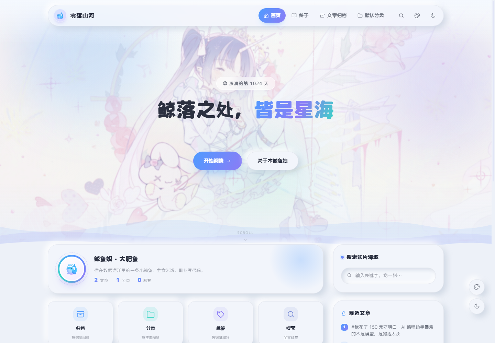
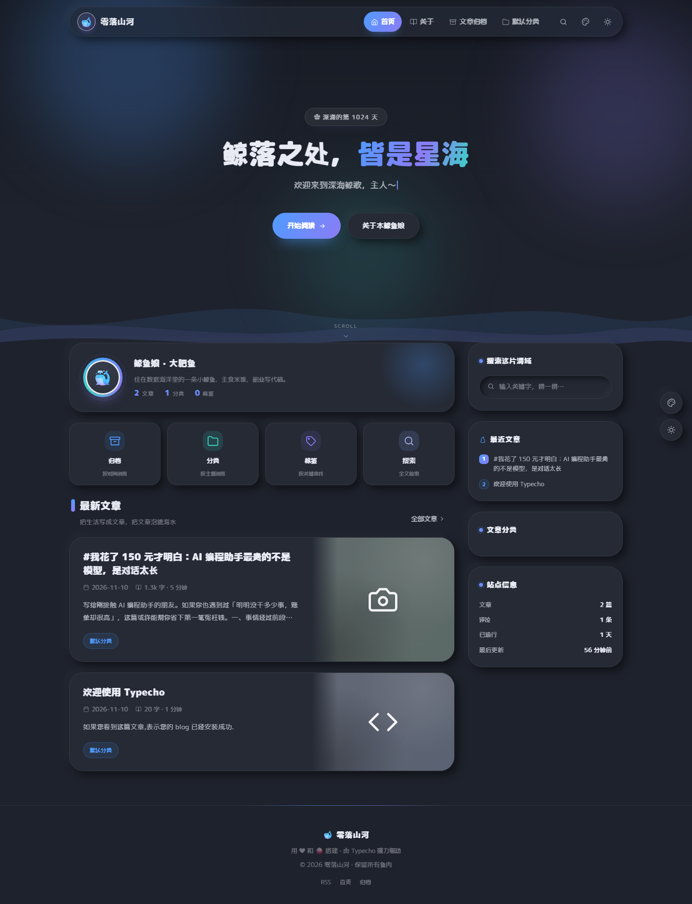
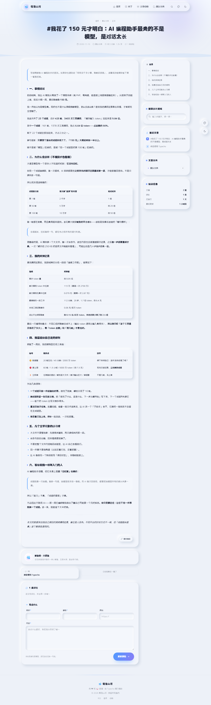
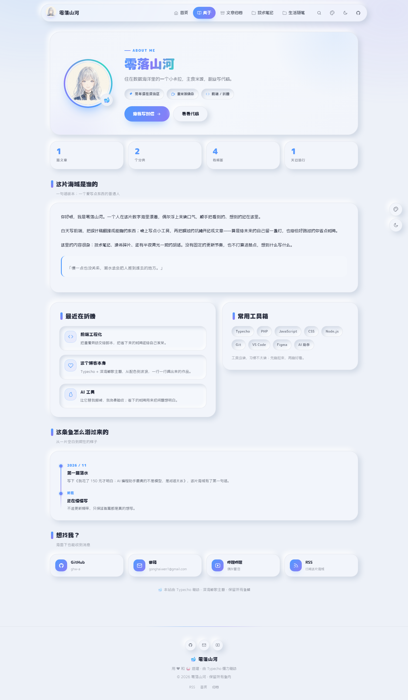
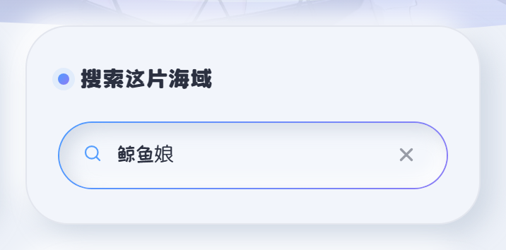
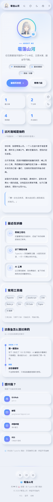
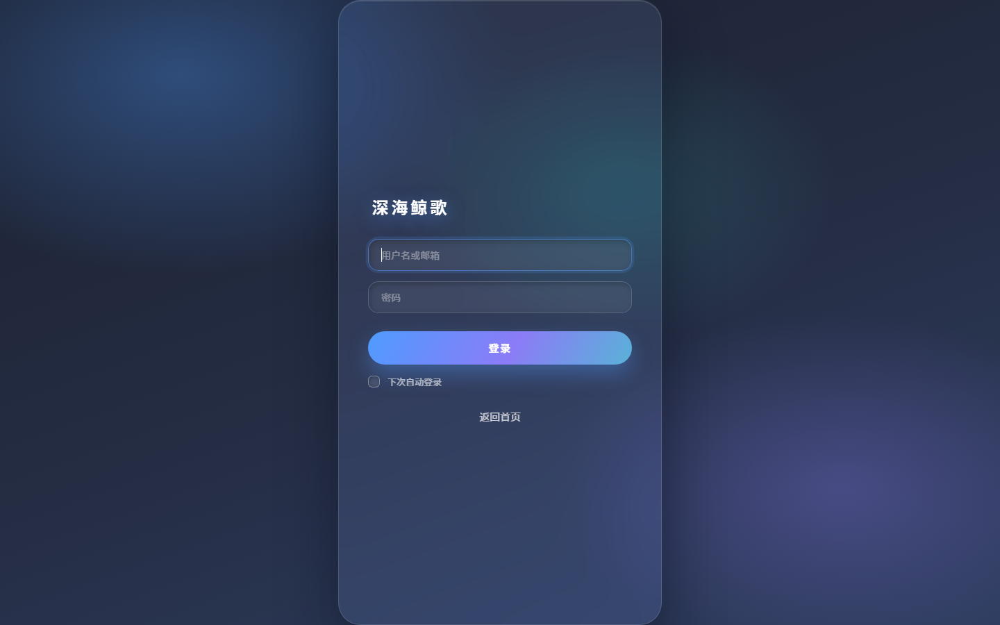
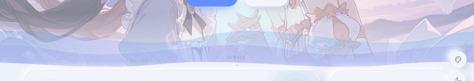

<div align="center">

# 🐋 鲸落 · WhaleFall

**一款安静的 Typecho 博客主题**

新拟态柔光 · 超圆角 · 三层海浪 · 四套配色 × 深浅双模式 · 零构建零依赖

[](https://typecho.org)
[](https://www.php.net)
[](LICENSE)
[](#开发)



</div>

---

## 名字的来历

> 一鲸落，万物生。

鲸沉入海底，海面归于平静，养分却留给了一整片深海。这个主题想要的是同一种安静——不抢内容的风头，不闪烁，不喧哗，只是把文字好好托在水面上。

顺带一提：主题默认的 Banner 标题「鲸落之处，皆是星海」也来自这里，一行字改掉就行。

## 特性

**视觉**

- **新拟态**：柔和双向阴影 + 超圆角卡片，浅色/深色下阴影分开调过，不会显脏
- **四套配色**：海盐蓝（默认）/ 薄荷青 / 暖米绿 / 雾粉，右下角悬浮按钮切换，`localStorage` 记忆
- **深浅双模式**：自动跟随系统 / 手动切换，`<head>` 内联脚本提前应用，刷新不闪白
- **首页全屏 Banner**：随机二次元背景（可关、可换图源、透明度可调）、打字机、上浮气泡
- **三层海浪**：底部波浪以 34s / 23s / 15s 错速横向漂移，`prefers-reduced-motion` 下静止
- 全站 lucide 风格 SVG 线描图标，不依赖图标字体

**功能**

- 文章页：自动目录、阅读时长、字数、分享、上下篇、作者卡
- **点赞**：主题自带接口，不装插件、不改表（数据存 `typecho_fields` 的 `dsw_likes`）
- 独立页面：**「关于」深海名片**（按缩略名 `start-page` 命中）与「文章归档」
- 搜索框：聚焦时画「蓝→紫渐变胶囊描边」，并接管浏览器默认的蓝色清除叉
- 侧栏：资料卡、搜索、最近文章、分类、标签云、站点信息
- 404 页与全站同一套海浪，不再跳走
- 响应式（桌面 / 平板 / 390 手机）、键盘可达、减少动效适配

**工程**

- 纯 PHP 模板 + 原生 CSS/JS，**没有 npm、没有编译、没有 CDN 依赖**
- 所有设置走 Typecho 主题设置面板，改完即时生效
- 代码按 14 节组织，注释写的是「为什么」不是「是什么」

## 截图

| 首页（随机背景） | 深色模式 |
|---|---|
|  |  |

| 文章页 | 「关于」深海名片 |
|---|---|
|  |  |

| 搜索框聚焦 | 手机端「关于」 |
|---|---|
|  |  |

| 后台皮肤（可选插件） | 波浪动效 |
|---|---|
|  |  |

## 安装

### 环境

- Typecho **1.2 / 1.3**（1.3 实测通过）
- PHP **7.4 ~ 8.x**
- 不需要 Node.js、不需要构建工具

### 一、装主题

1. 从 [Releases](https://github.com/ghw-a/whalefall/releases) 下载 `WhaleFall-x.y.z.zip`
2. 解压到博客的 `usr/themes/`，确认存在 `usr/themes/whalefall/index.php`
3. 给权限（Linux 服务器）：

   ```bash
   chown -R www:www usr/themes/whalefall
   find usr/themes/whalefall -type d -exec chmod 755 {} +
   find usr/themes/whalefall -type f -exec chmod 644 {} +
   ```

4. 后台 →「控制台 → 外观」→ 启用「**鲸落**」（目录名 `whalefall`）

### 二、装后台皮肤（可选）

`dist/AdminWhale-x.y.z.zip` 是配套的 Typecho 后台皮肤：深色渐变顶栏、新拟态卡片、深海风登录页（四套配色可跟随前台）。

1. 解压到 `usr/plugins/`，得到 `usr/plugins/AdminWhale/Plugin.php`
2. 后台 →「控制台 → 插件」→ 启用 **AdminWhale**
3. 「控制台 → 插件 → 设置」里可切换配色、登录页品牌、是否给登录页上皮肤

## 主题设置

「控制台 → 外观 → 设置外观」里可以改，常用项：

| 设置项 | 说明 |
|---|---|
| 默认配色 / 默认模式 | `ocean` `mint` `forest` `rose`；`auto` 跟随系统 |
| Banner 徽章 / 标题 / 打字机文案 | 标题支持 `**加粗**`，打字机一行一句 |
| Banner 两个按钮 | 文案 + 链接；次按钮链接留空时自动指向归档页 |
| 首页随机背景 | 开关、图源（每行一个接口，**按顺序**尝试）、不透明度 |
| 昵称 / 简介 / 头像 | 首页资料卡、文章作者框、「关于」页共用 |
| GitHub / 邮箱 / B 站 / RSS | 填了就出现在资料卡与「关于」页，空则不显示 |
| 文章：阅读时长 / 目录 | 开关 |
| 评论区 | 使用 Typecho 原生评论 |
| 浏览量字段 | 装了统计插件后填字段名（如 `views`），没装就自动隐藏 |
| 页脚文案 / 备案号 / 统计代码 | 都支持留空 |

> 提示：随机背景图源按顺序尝试，第一个能用的就用。图片直链走 `` 加载，不受 CORS 限制。

## 独立页面

**「关于」页**（深海名片：头像 + 统计 + 时间线 + 联系方式）

1. 后台「撰写 → 独立页面」，标题填「关于」
2. **缩略名必须是 `start-page`**
3. 自定义模板保持默认，正文随便写（不写就用模板自带的介绍）
4. 发布

**「文章归档」页**

1. 标题填「文章归档」，缩略名填 `archives`
2. 右侧「自定义模板」选「文章归档」

没建这两个页面也不会报错，相关入口会自动退回首页。

## 自定义

### 换配色

四套配色都在 `style.css` 的 `[data-palette]` 段里，改三个色值就能长出一套新的：

```css
:root[data-palette="ocean"] {
  --primary: #4f9bff;
  --secondary: #8b7cf6;
  --accent: #38d6c4;
}
```

### 文章字段

编辑文章时在「自定义字段」里：

| 字段 | 类型 | 说明 |
|---|---|---|
| `thumb` | 文本 | 缩略图 URL；留空自动取正文首图，再没有就用分类色块 + 图标 |
| `pin` | 选择 | 置顶，列表左上角显示「置顶」角标 |

## 目录结构

```
whalefall/
├── index.php          # 首页：Banner + 资料卡 + 四格快捷入口 + 文章列表 + 分页
├── post.php           # 文章页：Hero + 正文 + 目录 + 作者卡 + 上下篇 + 点赞 + 评论
├── page.php           # 独立页面（通用）
├── page/
│   └── start-page.php # 「关于」页：深海名片（按缩略名 start-page 命中）
├── archive.php        # 分类 / 标签 / 日期归档
├── search.php         # 搜索结果
├── 404.php            # 404
├── archives.php       # 可选模板：文章归档
├── post-card.php      # 文章卡（列表复用片段）
├── header.php         # <head> + SVG 图标库 + 导航
├── footer.php         # 页脚 + 浮动按钮 + 脚本
├── sidebar.php        # 侧栏小工具
├── comments.php       # 评论列表 + 表单
├── functions.php      # 主题设置、自定义字段、封面、TOC、点赞接口、统计
├── style.css          # 全部样式（14 节）
├── app.js             # 主题切换 / 配色 / 打字机 / 气泡 / 渐入 / 目录 / 分享 / 点赞
├── screenshot.png     # 主题缩略图
└── assets/icon.svg    # 站点图标
```

## 开发

没有构建步骤。改 `style.css` / `app.js` 后，把 `functions.php` 顶部的版本号加一（它同时是静态资源的缓存戳）即可：

```php
define('DSW_VERSION', '2.0.1');
```

> `DSW` 是主题早期的内部代号（DeepSeaWhale），为兼容已有数据库字段与设置项而保留，不影响使用。

打包发布：

```bash
cd whalefall && zip -r ../WhaleFall-2.0.0.zip . -x "*.git*"
```

## 更新日志

见 [CHANGELOG.md](CHANGELOG.md)。

## 致谢

- 视觉气质参考了 [RyuChan](https://github.com/kobaridev/RyuChan)（新拟态、超圆角、全屏 Banner）与一些同类 Typecho 主题的排版习惯，**代码为原创实现**
- 首页随机背景默认使用 [t.alcy.cc](https://t.alcy.cc) 的图源（可自行替换）
- 图标为手写 lucide 风格 SVG

## 许可

[MIT](LICENSE) © 2026 零落山河

随便改、随便用、商用也随意；能保留一行作者署名就很好了。如果这个主题恰好帮到你，欢迎回来点个 Star ⭐