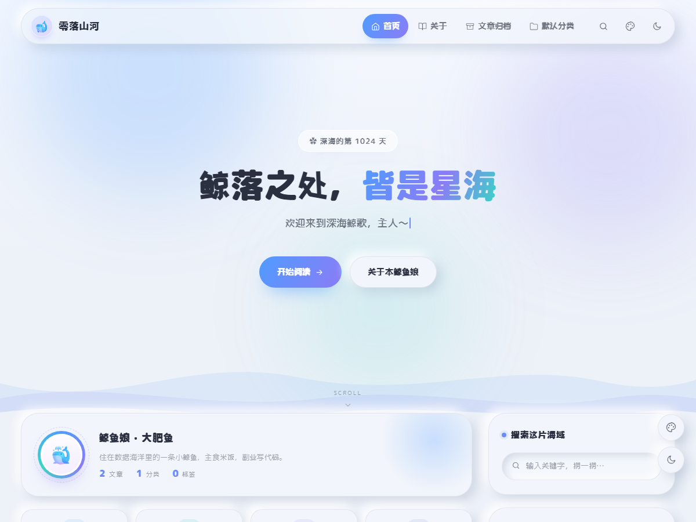

# 鲸落 · WhaleFall

> 一座安静的深海小岛。冷白或米色的底、蓝紫或草绿的主色，新拟态柔光、超大圆角、三层波浪、全站 SVG 线描图标，深色模式叫「深海蓝」。

**Typecho 1.2+ / 1.3 · PHP 7.4 ~ 8.2 · 零构建、零框架依赖**



---

## 特性

- **四套配色 × 深浅双模式**，共 8 种组合，右上角一键切换，`localStorage` 记忆
- **新拟态（Neumorphism）**柔和阴影 + 超圆角卡片，`--card` 与 `--bg` 同色系，阴影不显脏
- **Banner**：徽章 + 渐变标题 + 打字机副标题 + 上浮气泡 + 三层波浪 + SCROLL 提示
- **横版资料卡**、**四格快捷入口**、**置顶角标**、**热门/最近文章**
- **文章页**：面包屑、自动目录、作者卡、上下篇、分享（复制链接）、原生评论（支持嵌套回复）
- **全站 SVG 图标**，不依赖图标字体、不用 emoji 当 UI 图标
- **响应式**：1024 / 860 / 720 / 480 四档断点，移动端无横向溢出
- **无障碍**：`:focus-visible` 焦点可见、`aria-*` 语义、图片 `loading="lazy"`、装饰性封面链接 `tabindex="-1"`
- **`prefers-reduced-motion`** 下关闭全部动效
- **SEO**：`$this->header()` + OG 标签 + 文章结构化信息

---

## 安装

1. 下载 `whalefall.zip`，解压后把 `whalefall` 整个目录上传到：

   ```
   站点根目录/usr/themes/
   ```

   最终路径应为 `usr/themes/whalefall/index.php` 存在。

2. 确保目录权限正确（Linux）：

   ```bash
   chown -R www:www usr/themes/whalefall
   chmod -R 755 usr/themes/whalefall
   chmod 644 usr/themes/whalefall/*.php
   ```

3. 后台 →「控制台 → 外观」，找到「鲸落」→ 启用。

4. 进入「设置外观」，按需填写设置项后保存。

> **提示**：首次启用后建议点一次「保存设置」，让默认值写入数据库。

### 伪静态

主题同时兼容两种模式：

- **默认（PATH_INFO）**：`index.php/archives/1/`，后台「设置 → 永久链接」保持默认即可
- **伪静态（Rewrite）**：后台开启后，Nginx 建议加：

  ```nginx
  if (-f $request_filename/index.html) { rewrite (.*) $1/index.html break; }
  if (-f $request_filename/index.php) { rewrite (.*) $1/index.php; }
  if (!-f $request_filename) { rewrite (.*) /index.php; }
  ```

---

## 主题设置

后台「控制台 → 外观 → 设置外观」。

| 设置项 | 类型 | 默认值 | 说明 |
|---|---|---|---|
| 默认配色 | 选择 | 海盐蓝 | 海盐蓝 / 薄荷青 / 暖米绿 / 雾粉 |
| 默认深浅色 | 选择 | 跟随系统 | 跟随系统 / 始终浅色 / 始终深色 |
| Banner 徽章文案 | 文本 | `✿ 深海的第 1024 天` | 留空则不显示 |
| Banner 标题 | 文本 | `鲸落之处，**皆是星海**` | `**` 包住的部分渲染成渐变 |
| 打字机文案 | 多行 | 3 句 | 一行一句，只写一行则不做动画 |
| Banner 主按钮文案 / 链接 | 文本 ×2 | `开始阅读` / 空 | 链接留空则滚动到文章列表 |
| Banner 次按钮文案 / 链接 | 文本 ×2 | `关于本鲸鱼娘` / 空 | 链接留空则指向归档页 |
| 首页随机人物背景 | 开关 | 显示 | 访问首页时随机取一张二次元插画，淡入铺在 Banner 上 |
| 背景图接口 | 多行 | `t.alcy.cc/ycy`（首选）、`t.alcy.cc/pc`、`t.alcy.cc/moe` | 一行一个，按顺序尝试、第一个能用就用；JSON 接口取 `url` 字段，图片直链直接当背景，失败自动换下一个 |
| 背景图不透明度 | 文本 | `0.5` | 建议 0.2 ~ 0.6，太高会压住标题 |
| SCROLL 提示 | 开关 | 显示 | — |
| 四格快捷入口 | 开关 | 显示 | 归档 / 分类 / 标签 / 搜索 |
| 头像地址 | URL | 空 | 留空显示 🐳 |
| 昵称 | 文本 | `鲸鱼娘 · 大肥鱼` | 资料卡、作者卡共用 |
| 一句话简介 | 多行 | — | 同上 |
| GitHub / 邮箱 / B站 / RSS | 文本 ×4 | 空 | 留空则不渲染该图标 |
| 页脚文案 | 文本 | `用 ❤ 和 🍚 搭建` | — |
| 备案号 / 链接 | 文本 ×2 | 空 | 留空不显示 |
| 统计代码 | 多行 | 空 | 原样输出到 `</body>` 前 |
| 建站日期 | 文本 | 空 | `2026-01-01`，用于「已运行 N 天」 |
| 显示阅读时长 | 开关 | 显示 | 字数 + 分钟数 |
| 文章页自动目录 | 开关 | 显示 | h2/h3 两个以上标题才生成 |
| 评论方案 | 选择 | Typecho 原生 | 或「关闭评论」 |
| 浏览量字段名 | 文本 | 空 | 装了统计插件才填，留空全站不显示浏览量 |
| 侧栏文章标题 | 文本 | `最近文章` | 装浏览量插件后可改「热门文章」 |

---

## 文章自定义字段

编辑文章时，「自定义字段」区域（若被折叠，请先在「设置 → 内容」里开启）：

| 字段 | 类型 | 说明 |
|---|---|---|
| `thumb` | 文本 | 缩略图 URL。留空时自动取正文第一张图；再没有则用分类色块 + SVG 图标 |
| `pin` | 选择 | 置顶。选「是，置顶」后列表显示「置顶」角标 |

缩略图优先级：**自定义字段 → 正文首图 → 色块 + 图标**。

---

## 独立页面模板

主题内置一个自定义模板「**文章归档**」（`archives.php`），按年份分组列出全部文章。

1. 后台「撰写 → 独立页面」
2. 标题填「文章归档」，缩略名填 `archives`
3. 右侧「自定义模板」选择「文章归档」
4. 发布

发布后导航会自动出现「文章归档」入口，首页四格「归档」、页脚「归档」也会指向它。

> 没建这个页面也不会报错，相关入口会自动退回首页。

### 「关于」页（按缩略名命中，不用选模板）

主题内置一张「深海名片」样式，文件是 `page/start-page.php`。Typecho 1.3 找模板时先看 `{类型}/{缩略名}.php`，所以：

1. 后台「撰写 → 独立页面」
2. 标题填「关于」，**缩略名填 `start-page`**
3. 自定义模板保持默认（不要选）
4. 正文写自我介绍（不写就看模板自带的默认文案）

页面自动带上：头像 + 昵称 + 简介 + 状态胶囊、文章/分类/标签/运行天数统计、最近两篇真实文章拼的时间线、主题设置里的社交链接卡片（邮箱 / GitHub / B 站 / RSS 兜底）。无侧栏、无评论区，纯单列。

> 缩略名必须是 `start-page`，改成别的就会退回普通 `page.php` 样式。

---

## 文件结构

```
whalefall/
├── index.php          # 首页：Banner + 资料卡 + 四格 + 列表 + 分页
├── post.php           # 文章页：Hero + 正文 + 目录 + 作者卡 + 上下篇 + 评论
├── page.php           # 独立页面（通用）
├── page/
│   └── start-page.php # 「关于」页：深海名片（按缩略名 start-page 命中）
├── archive.php        # 分类 / 标签 / 日期归档
├── search.php         # 搜索（含空状态）
├── 404.php            # 404（「这片海域没有内容喵」）
├── archives.php       # 可选模板：文章归档
├── post-card.php      # 单篇文章卡（复用片段）
├── header.php         # <head> + SVG 图标库 + 导航
├── footer.php         # 页脚 + 浮动按钮 + 脚本
├── sidebar.php        # 侧栏小工具（只输出内部，容器由模板提供）
├── comments.php       # 评论列表 + 表单
├── functions.php      # 设置面板、自定义字段、字数/时长、封面、TOC、统计
├── style.css          # 全部样式（14 节为主题适配层）
├── app.js             # 主题切换 / 配色 / 打字机 / 气泡 / 渐入 / 目录 / 分享
├── screenshot.png     # 主题缩略图 1200×900
├── README.md
└── assets/
    └── icon.svg       # 站点图标
```

---

## 常见问题

**Q：刷新时闪白？**
深浅色由 `<head>` 内的内联脚本在 CSS 之前执行，正常不会闪白。若你的缓存插件改写了 `<head>` 顺序，请把主题的内联脚本移到最前。

**Q：Google Fonts 加载慢或失败？**
字体有完整 fallback 栈（系统圆体 / 微软雅黑 / system-ui），加载失败只影响字形圆润度，不影响布局。需要更稳可以把字体文件放到 `assets/fonts/` 并改用 `@font-face`。

**Q：404 页面显示的是 Nginx 默认页？**
宝塔等面板默认有 `error_page 404 /404.html;`，会把 Typecho 的 404 拦截成静态 404。注释掉这一行再 `nginx -t && nginx -s reload`，就能看到主题的 404 页面。

**Q：浏览量不显示？**
Typecho 本身不统计浏览量。安装统计插件（字段名一般为 `views`）后，在主题设置里填上「浏览量字段名」，全站才会显示。没有插件时该处直接隐藏，不会出现 0。

**Q：侧栏为什么叫「最近文章」不是「热门」？**
没有浏览量数据时，热门排序没有意义。装了插件后，可在设置里把标题改成「热门文章」。

**Q：评论回复按钮点了没反应？**
回复依赖 Typecho 内置的 `TypechoComment` 脚本，需要后台「设置 → 评论」里**开启「评论回复」并勾选「嵌套评论」**。

---

## 许可

MIT License · 署名可保留亦可替换，请勿用于违法用途。

*作者：零落山河 · 主题版本 1.0.9*